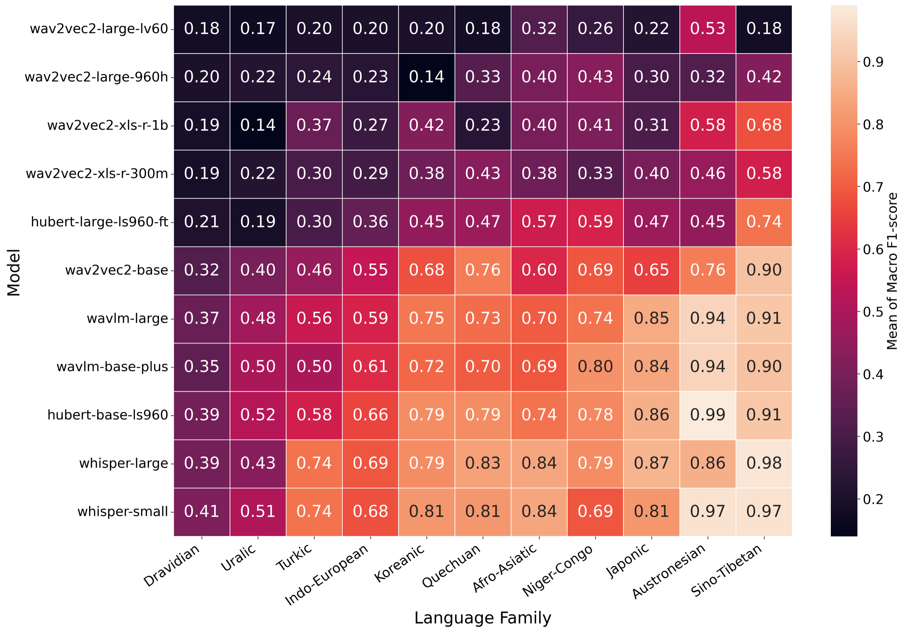

<div align="center">

# KuralHub

**Exposing Typological Capability Frontiers in Multilingual Speech Emotion Recognition**

[Luxshan Thavarasa](https://luxshan2000.github.io/)\*, Jubeerathan Thevakumar\*, Thanikan Sivatheepan, Uthayasanker Thayasivam
University of Moratuwa, Sri Lanka · Interspeech 2026

[](https://www.isca-archive.org/interspeech_2026/thavarasa26_interspeech.pdf)
[](https://doi.org/10.21437/Interspeech.2026-3502)
[](https://aaivu.github.io/KuralHub/)
[](https://github.com/aaivu/KuralHub/stargazers)

[Website](https://aaivu.github.io/KuralHub/) · [Dataset catalog](https://aaivu.github.io/KuralHub/datasets.html) · [Results](https://aaivu.github.io/KuralHub/benchmark.html) · [Contribute](CONTRIBUTING.md)

</div>

KuralHub (*kural* is Tamil for "voice") collects speech emotion recognition (SER) datasets for the 70 most widely spoken languages and benchmarks 11 self-supervised speech models on 33 of them, covering 29 languages. We found datasets for 45 of the 70 languages and documented 90 in total.

<p align="center">
  
</p>

## Findings

- No model is best for every language. Whisper had the highest mean F1 (0.70), then HuBERT-base (0.68) and WavLM (0.63 to 0.64), but HuBERT won for nine languages and WavLM for English and Swahili.
- Every model struggles with Dravidian languages. Kannada averaged 0.275 accuracy and Tamil 0.306.
- More pre-training data is not enough. Mandarin and Indonesian were easy, while French, Spanish and Russian were not.
- Bigger models did not do better. log(parameters) is negatively correlated with F1 (r = −0.18, p = 0.0007).
- Fear is the hardest emotion to recognise (F1 0.38). Anger and neutral are the easiest.

The [website](https://aaivu.github.io/KuralHub/) has the full write-up, all 363 runs, one page per language and a [guide to speech emotion recognition](https://aaivu.github.io/KuralHub/speech-emotion-recognition.html).

## Repository

```
datasets/<Language>/   one folder per language: Readme.md plus one file per dataset
results/               classification reports, confusion matrices and loss curves for every run
src/                   data loading, model and training code
scripts/               website build
docs/                  the website (GitHub Pages)
template/sample/       template for adding a dataset
```

## Quick start

Requires Python 3.12 or newer.

```bash
git clone https://github.com/aaivu/KuralHub.git && cd KuralHub
make setup                                            # .venv + requirements
make download_dataset                                 # needs ~/.kaggle/kaggle.json
make meta_extract
DATASET=EMOTA BASE_MODEL=WAVLM_LARGE make train_model
```

`DATASET` and `BASE_MODEL` take the names in `src/utils/constant.py`. The per-run results are also available as [`docs/data/runs.csv`](docs/data/runs.csv).

## Contributing

If KuralHub is useful to you, please star the repository. It helps other researchers find it and keeps us adding languages, datasets and models.

25 of the 70 languages still have no dataset we could find, and the benchmark covers 11 models so far. You can [suggest a dataset](https://github.com/aaivu/KuralHub/issues/new?template=add-dataset.yml) or [suggest a model](https://github.com/aaivu/KuralHub/issues/new?template=add-model.yml) with a short form, or add either one yourself by following [CONTRIBUTING.md](CONTRIBUTING.md).

## Citation

Official BibTeX from the ISCA Archive (also in [`CITATION.bib`](CITATION.bib)):

```bibtex
@inproceedings{thavarasa26_interspeech,
  title     = {{KuralHub: Exposing Typological Capability Frontiers in Multilingual Speech Emotion Recognition}},
  author    = {Luxshan Thavarasa and Jubeerathan Thevakumar and Thanikan Sivatheepan and Uthayasanker Thayasivam},
  year      = {2026},
  booktitle = {{Interspeech 2026}},
  pages     = {4673--4678},
  doi       = {10.21437/Interspeech.2026-3502},
  issn      = {2958-1796},
}
```

If you use one of the catalogued datasets, please cite its authors too. Each dataset file includes their BibTeX.

## Contact

- [Luxshan Thavarasa](https://luxshan2000.github.io/) (project lead): luxshan.20@cse.mrt.ac.lk
- Jubeerathan Thevakumar: jubeerathan.25@cse.mrt.ac.lk
- Thanikan Sivatheepan: thanikan.20@cse.mrt.ac.lk
- Uthayasanker Thayasivam: rtuthaya@cse.mrt.ac.lk

\*Equal contribution. Department of Computer Science and Engineering, University of Moratuwa.

We thank Braveenan Sritharan for mentorship, and the creators of every dataset listed here for releasing their data openly or on request.

## License

Code and documentation are released under the [MIT License](LICENSE). The datasets are not redistributed here and keep their own licences.
